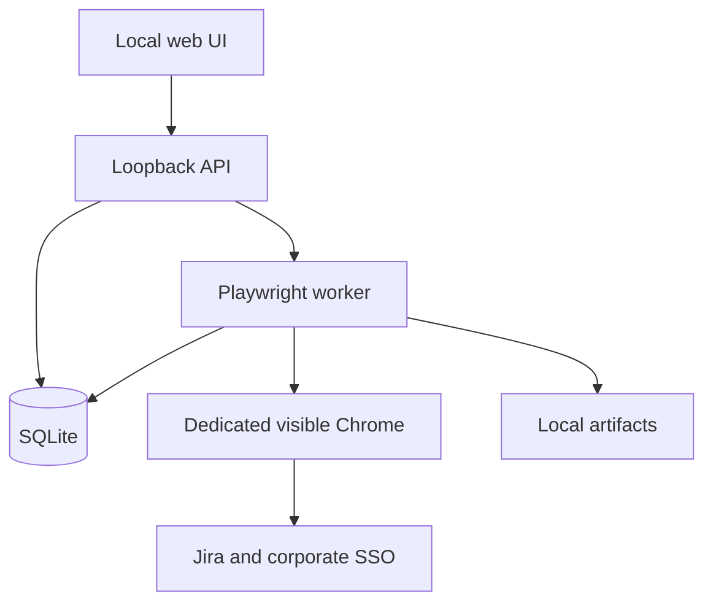

# Jira Bulk Transition — Technical Implementation Specification

Version 1.1 · 5 October 2026 · Companion to PRD.md.

Implementation clarification (5 October 2026): target instance is Jira v9 Data Center. Develop against a local fixture first; exact minor version, workflows and DOM selectors remain unvalidated. See `IMPLEMENTATION_STATUS.md` for delivered scope.

## 1. Architecture and deployment
A local React/Vite TypeScript UI communicates with a Node.js/Fastify API over loopback. A separate Node worker owns Playwright, the visible browser context and the job lifecycle. SQLite stores plans, versions, item states and append-only events. The API serves the production UI; users start one application launcher and open its local URL.

A hosted frontend alone cannot launch Playwright on the user's laptop or access its dedicated profile. Remote deployment would require a separately installed local agent; exclude that from MVP.



Proposed dependencies: React, Vite, TypeScript, Fastify, Zod, Playwright, TypeScript compiler API for AST parsing, SQLite through a maintained Node driver, Vitest and Playwright Test. Pin supported releases and commit a lockfile at implementation time. Use an active Node LTS compatible with selected packages; validate Windows support during the spike. No Redis, cloud queue or LLM dependency.

## 2. Repository structure
```text
apps/web/src/{screens,components,api,state}
apps/server/src/{routes,security,jobs,storage}
apps/worker/src/{browser,recorder,normalizer,jira,runner,recovery,preview}
packages/contracts/src/{flow,plan,events,schemas}
fixtures/jira-ui/
tests/{unit,integration,e2e,recovery}
docs/
```
Runtime data lives outside the repository under an OS-user application-data directory: database, profiles, artifacts and recordings. Use a generated connection ID for profile paths. Do not derive filesystem paths directly from issue keys or uploaded filenames. Exclude data from Git and diagnostic bundles.

## 3. Browser ownership and login
Launch `chromium.launchPersistentContext(profileDir, {channel: 'chrome', headless: false})`; require installed Google Chrome and show a setup error if unavailable; do not silently substitute another browser. Never select the user's normal browser profile. Do not disable TLS verification or corporate browser policies to make automation work.

Acquire a durable profile lease before launch. The worker heartbeat renews it; stale recovery checks process ownership before clearing. Recording, login, preview, validation and execution all share this exclusive lease. The API returns 409 if another job owns it.

Login launches a Jira page and waits for the user. A session check must verify a Jira issue-specific landmark/identity at the configured base URL rather than trusting an HTTP 200. Authentication expiry suspends the job; re-authenticate manually and recheck the pending item before continuing. No recording/tracing during SSO or credential entry.

## 4. Recorder implementation — bounded MVP
Playwright supplies interactive code generation; it does not supply a public general-purpose API that automatically turns arbitrary demonstrations into our domain flow model. Implement MVP using a managed codegen process and a guided review/import workflow.

1. Obtain exclusive browser lease; ensure user has authenticated and close the ordinary context before codegen uses that same profile.
2. Spawn the pinned local Playwright CLI with an argument array, never a shell string: `codegen --browser chromium --channel chrome --user-data-dir <dedicated-profile> --target playwright-test --output <raw.ts> <sample-issue-url>`. Confirm exact flags against the installed release in the spike.
3. The user records one transition and a final status text assertion in the visible browser/Inspector. The web UI explains these separate windows and waits for recording completion.
4. Only import after the recorder exits and flushes output. Preserve the raw file as restricted evidence; do not evaluate it.
5. Parse using the TypeScript compiler API. Accept only an explicit subset: issue `goto`, locators, click, fill, selectOption, check/uncheck and supported visibility/text assertions. Strip test wrapper/imports structurally. Reject loops, arbitrary calls, evaluate, request clients, scripts and external navigation.
6. Generate draft JSON plus findings with source-line references. A wizard binds sample URL to `{issueKey}`, marks discovery/mutation phases, identifies issue/status/type readers and asks for explicit expected destination status.
7. Convert recorded literal field values into explicit constant/shared/per-issue parameters. Never infer a universal date, resolution or comment from the sample.
8. Validate locator uniqueness and replay on a second issue only after user confirmation.

MVP has human-reviewed normalization. Auto-generating robust selectors from arbitrary DOM and fully integrated recorder controls are later work. If codegen produces unsupported custom widgets, keep the draft blocked and add a typed widget handler with fixture coverage. Avoid private Playwright recorder internals.

## 5. Flow contract
Persist canonical JSON; YAML may be exported through a safe serializer. Validate all definitions with Zod, size limits and allowed action enums. Example abbreviated contract:

```typescript
interface FlowVersion {
  schemaVersion: 1;
  id: string;
  version: number;
  connectionId: string;
  name: string;
  state: 'draft' | 'validated' | 'retired';
  scope: { projectKeys: string[]; issueType: 'Epic'; sourceStatuses: string[] };
  targetStatus: string;
  transitionLabel: string;
  readers: { issueKey: LocatorSpec; issueType: LocatorSpec; status: LocatorSpec };
  discovery: ReadOnlyStep[];
  execution: ExecutionStep[];
  parameters: ParameterSpec[];
  verification: { status: LocatorSpec; expected: string; reload: true };
  validationEvidence: ValidationEvidence[];
}
```

`LocatorSpec` is a typed union: role plus exact accessible name; label; test ID; exact text; or explicitly reviewed stable CSS. Permit parent scope and bounded named variants; no XPath or arbitrary JS in MVP. Exactly one match must be visible where an action requires one target. Role names and strings are literal by default; reviewed regex support is optional and must be bounded.

Supported execution actions: click, fill, select native option by label/value, select explicitly supported combobox option, check, uncheck, wait visible/hidden, assert text. All waits have deadlines. Each action has a declared `effect: 'read' | 'mayMutate'`, with validation disallowing `mayMutate` from discovery. Optional dialogs use a bounded condition that waits for either a known dialog or verified completion; unknown overlays block.

Discovery can open a verified menu and read choices, but cannot click a transition entry. Selecting a transition may immediately update Jira even without a submit button. The first such click is the mutation boundary. The reviewer confirms that menu-opening steps are safe for this Jira variant.

Flow labels and target status are separate. Require explicit source-status variants when the status control's accessible name changes. A flow edit creates a new immutable version and invalidates validation; never overwrite activated content.

## 6. Domain services
- ConnectionService: base URL/context path validation, browser channel, session lifecycle.
- RecorderService/Normalizer: capture process, AST import, draft findings and typed flow output.
- FlowService: version creation, schema validation, scope and validation evidence.
- JiraIssuePage: navigate, read identity/type/status, discover controls, execute approved steps, reload verification.
- Planner: bounded input, duplicate handling, read-only observations, per-item parameters and immutable plan.
- Runner: single-item processing, durable mutation journal, cancellation boundaries and result recording.
- Reconciler: restart and uncertain-result checks without blindly repeating submissions.
- Reporter: CSV/JSON and restricted artifact access.
- LivePreviewService: transient viewport capture, freshness metadata and authenticated frame delivery.

Keep selectors in the flow model and widget handlers; keep bulk logic independent of Jira DOM details.

## 7. Local API contracts
All mutations require a same-origin session, CSRF token and schema validation. IDs are generated by the server; artifact paths are never accepted from callers.

| Method/path | Request / response behaviour |
|---|---|
| POST /api/connections | Validated base URL, channel → connection ID |
| POST /api/connections/:id/login | Create login job → 202 job ID |
| GET /api/connections/:id/session | authenticated / login_required / unknown |
| POST /api/recordings | Connection, sample key, target → recorder job |
| POST /api/recordings/:id/import | Import completed recording → draft and findings |
| POST /api/flows/:id/versions | Reviewed typed definition → immutable draft version |
| POST /api/flow-versions/:id/validation-preview | Second key → read-only test plan |
| POST /api/flow-versions/:id/validate | Confirmed test-plan hash and values → live validation job |
| POST /api/previews | Version, issue keys/CSV, parameters → preview job |
| GET /api/plans/:id | Observations, selected scope, plan hash, expiry |
| POST /api/runs | Plan ID/hash, selected keys, idempotency key, confirmation → execution job |
| POST /api/jobs/:id/pause,resume,stop | Durable control request; stop prevents future items |
| GET /api/jobs/:id/events | SSE stream with monotonically increasing event IDs |
| GET /api/jobs/:id/preview/frame | Latest in-memory JPEG frame; authenticated, Cache-Control: no-store; no frame → 204 |
| GET /api/runs/:id | Durable results and progress |
| GET /api/runs/:id/export?format=csv\|json | Download escaped report |
| GET /api/artifacts/:id | Authorized local artifact by opaque ID |

Use 400 for invalid input, 409 for stale plan/profile busy/version change, 422 for unsupported flow and 202 for asynchronous work. A repeated run creation idempotency key returns the existing run. SSE reconnect uses Last-Event-ID; polling snapshot is fallback.

## 7a. Live Chrome preview implementation
MVP uses Playwright `page.screenshot({type: 'jpeg', quality: 65, fullPage: false})` on the active execution page at a best-effort two frames per second. The worker sends only the latest frame and metadata to the API through IPC. The React viewer polls the authenticated frame endpoint without overlapping requests and displays the JPEG via a revocable object URL. This avoids coupling the MVP to private recorder internals or a Chrome-only screencast transport.

Use a fixed automation viewport such as 1280 × 800, scaled to fit the panel. Expand changes display size, not the automation viewport. Metadata includes job ID, item key, step ID, sequence, capture timestamp and preview state. Label stale after three seconds; discard late frames from prior items/jobs and show a navigation placeholder until fresh matching evidence arrives. Use a response metadata header or a coordinated snapshot contract so frame identity and image cannot be mixed. SSE continues carrying durable progress independently of image polling.

Allow only one in-flight capture and one pending latest frame per job; never accumulate a video queue. Apply a short capture timeout and skip frames during navigation or contention. Browser actions and verification have priority. Stop capture when no viewer subscribes, the page closes, the job finishes or authentication starts. Resume on a fresh authorized viewer request after session/issue checks. Background tabs may poll more slowly; dashboard refresh reconnects without restarting the job.

The panel is view-only in MVP. Pointer/keyboard events are not forwarded to Chrome. Manual intervention requires pausing at a safe boundary and using the actual Chrome window. Jira is not loaded in an iframe: the local viewer receives images, avoiding dependencies on Jira framing policy and cross-origin access.

Authenticate every frame request using the same local session; enforce job access, Host/Origin checks, no-store caching and no LAN exposure. Keep frames in bounded memory only; discard on job change and logout. Capture only after a verified Jira issue page/known transition dialog is present. On SSO redirects, unknown pages or session uncertainty, clear prior frames and show “Login required — continue in Chrome.” Apply configured sensitive-field masks, and keep preview disabled until identity is checked after navigation. Restricted failure screenshots and opt-in traces remain separate persistent artifacts.

This is a near-live view, not a guaranteed frame-by-frame video. Fast clicks may fall between frames; pair each action with the durable step timeline. Optional future CDP screencasting/WebSocket transport can improve smoothness after a Chrome performance spike, without changing runner semantics.

## 8. Plan binding and execution algorithm
A plan binds connection, flow version hash, normalized input, selected items, field values, observed source states and creation time. Default expiry: 15 minutes, configurable. Changing selection is allowed only within eligible rows; server computes and confirms the final execution hash. Changing values/version/input requires preview again.

For each selected item:
1. Persist item as rechecking; navigate to a URL built from allowlisted base URL and validated issue key. Check final page origin and issue identity.
2. Read type and status. Already target → skip. Mismatch with expected source or unsupported scope → block.
3. Recheck transition availability through safe discovery. Resolve shared/per-issue field values; reject missing values.
4. Persist `mutation_intent` with step index before each potentially mutating click, then execute once.
5. For known dialogs, inspect known required controls, fill approved values and persist another intent before submit. Unknown fields or validation messages prevent further submission and produce actionable results.
6. Wait for known completion evidence, reload the issue and verify exact expected status and identity.
7. Success only after reload verification; otherwise reconcile and classify failure or uncertainty.

Allow bounded retries for read-only navigation/reads only. After a submit timeout, reload/read first. If target is present, record success with recovered evidence. If not provable, record `outcome_uncertain` and require user review. Do not automatically repeat a mutation, even if status remains unchanged: transition side effects may already have occurred.

Pause takes effect at the next safe item boundary. Stop is cooperative; an in-flight submission is completed or reconciled before termination. The UI explains that already submitted changes are not undone.

## 9. Persistence model
| Table | Principal fields |
|---|---|
| connections | id, base_url, channel, profile_reference, created_at |
| flow_versions | id, flow_id, version, canonical_json, hash, lifecycle |
| validations | version_id, sample_key, source, target, outcome, verified_at, evidence |
| recordings | id, sample_key, restricted_artifact_id, findings |
| plans | id, version_id, hash, input_json, values_json, observations_json, expires_at |
| runs | id, plan_id, execution_hash, idempotency_key, state, timestamps |
| run_items | run_id, ordinal, key, observed_source, target, state, reason, last_step |
| events | sequence, run_id, item_id, type, redacted_payload, timestamp |
| artifacts | id, run_id, relative_path, kind, retention_until |
| leases | profile_id, owner_pid, heartbeat, job_id |

Enable WAL and transactions. Mutation intent and state commit before the browser action. Unique `(run_id, key)` prevents duplicate rows; unique idempotency key prevents duplicate run creation. A local journal cannot guarantee exactly-once Jira side effects; reconciliation and no blind retry are the deliberate response to that limitation.

Run states: queued, running, pause_requested, paused, login_required, stop_requested, completed, completed_with_issues, stopped, interrupted. Item states: pending, rechecking, blocked, skipped, executing, verifying, succeeded, failed, outcome_uncertain. A job that loses the worker becomes interrupted. Startup reconciles executing/verifying items and pauses for review before pending mutations resume.

## 10. Input, security and artifacts
Accept pasted keys separated by whitespace/comma and bounded UTF-8 CSV with `issueKey`. Validate configurable project-key syntax, numeric suffix, maximum 100 unique issues and upload size 1 MB. Reject URLs or formulas as issue keys. Escape CSV cells starting with `=`, `+`, `-`, `@`, tab or carriage return to prevent spreadsheet formula execution.

Bind IPv4/IPv6 loopback only, reject unexpected Host and Origin, no wildcard CORS. Bootstrap an HTTP-only SameSite session through the local launcher; require CSRF for every mutation and job control. Do not expose the server on LAN. Resolve asset paths under a fixed application-data root and reject traversal.

Jira credentials are never stored separately. The browser profile contains sensitive authentication state; protect it with user-only OS permissions. Database encryption is not assumed; rely on approved OS account and device protections, with optional future encryption. Reports redact field values configured sensitive.

Capture screenshots on failure after checking no authentication screen is present. Tracing is opt-in for troubleshooting because DOM/network evidence may contain corporate content. Use a local trace viewer; do not upload traces externally. Default artifact retention 30 days; report metadata retention 90 days, both configurable. Profile reset/sign-out warns it removes the saved session and waits for the lease to be free.

## 11. Testing and release gates
Build a local Jira-like fixture that includes direct transitions, modal transitions, dynamically named status controls, custom comboboxes, required-field errors, denied permissions, session expiry and slow responses. It must record every submitted mutation so tests can detect duplicate actions.

Unit tests: input parsing, AST allowlist, flow schema, plan hashes, scope matching, parameter resolution, formula-safe export. Integration: leases, durable intent, idempotency, SSE replay and restart. E2E: teach/import/review/validate/preview/execute/report on fixtures.

Critical scenarios: eligibility preview performs zero mutations; live viewer follows active item/dialog and step; frame disconnect marks stale without restarting a run; login screens are hidden and old frames cleared; slow viewers do not stall execution; unauthorized frame access is rejected; frames are not persisted; wrong issue/type blocks; stale status blocks; second validation key is required; unsupported source variants block; duplicate UI Execute clicks create one run; crash before/after each mutation never triggers blind replay; submit timeout reconciles; auth expiry pauses; unknown dialog stops; cancellation does not start the next issue; successful status survives reload.

Live release gates: Jira discovery spike, one authorized teaching issue, second authorized validation issue, 3–5 issue pilot, then a 40–50 issue batch. Record installed browser/Playwright versions and exact scope. Do not build tests that transition production Jira automatically during CI.

## 12. Implementation backlog
| Milestone | Tasks | Deliverable |
|---|---|---|
| M0 | Inspect Jira, test browser policy, map state/control variants and safe boundaries | Jira compatibility notes and locator evidence |
| M1 | Scaffold contracts/UI/API/worker, data migrations, login, leases and fixtures | Runnable local shell |
| M2 | Managed codegen, AST subset, editor, parameterization, immutable versions | Human-reviewed draft generation |
| M3 | Live-test confirmation, validation evidence, safe preview | Activated workflow and bound plans |
| M4 | Sequential runner, durable journal, dialogs, reload verification, SSE and live viewport delivery | Controlled bulk execution |
| M5 | Reconciliation, exports, retention, Windows launcher and operator guide | Pilot-ready package |

Suggested commands at implementation: `npm run dev`, `npm run build`, `npm run start`, `npm run test`, `npm run test:e2e`. Production start serves built UI and API and launches the worker. Document corporate proxy/certificate and offline installation requirements; never bypass TLS failures.

## 13. Operator acceptance checklist
The final application must explain that teaching and validation change real issues; preview is read-only; browser automation uses the logged-in user's Jira permissions; flows apply only to validated variants; outcomes are verified after reload; stop does not roll back earlier changes; uncertain items require reconciliation. All exports include enough evidence to review a run without opening debug traces.

## 14. Sources and boundary of evidence
Official Playwright references checked for this plan:
- Code generation, locator picking and user data directories: https://playwright.dev/docs/codegen
- Persistent contexts and browser channel options: https://playwright.dev/docs/api/class-browsertype
- Locator guidance: https://playwright.dev/docs/locators
- Screenshot capture: https://playwright.dev/docs/screenshots
- Tracing API: https://playwright.dev/docs/api/class-tracing
- Trace inspection: https://playwright.dev/docs/trace-viewer

These establish available Playwright primitives. The local application architecture, normalization pipeline, plan binding and recovery policies are proposed engineering designs. Actual Jira selectors, workflow validations and managed Chrome compatibility remain to be discovered in the user's environment.

## Subsequent implementation extension — 5 October 2026

The user authorized a separate interactive Teach Workflow screen and configurable Epic status transitions. The local fixture release now permits input through the teaching viewport and field editor, emits reviewable/editable Playwright scripts, saves immutable drafts and requires second-Epic validation before bulk use. This extends the earlier view-only teaching assumption; the existing bulk execution viewport remains view-only. Source status, transition label and destination are configured independently. Actual Jira connections remain disabled pending a Jira 9 Data Center adapter and environment validation. See `IMPLEMENTATION_STATUS.md` and the README for supported input/script constraints.
